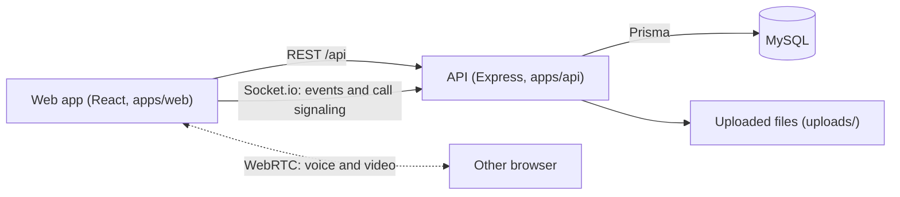
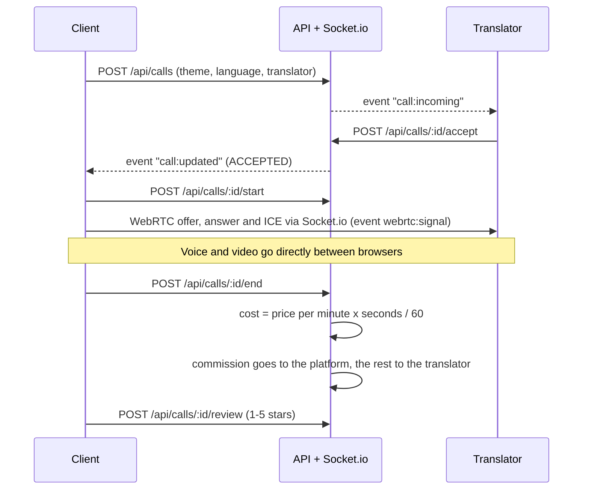

# MORAGO: architecture

## Parts

- **Web app**: pages for the client, the translator and the admin. The login token is kept in the browser and sent in the `Authorization` header.
- **API**: modules for auth, translators, calls, wallet, payouts, reviews, conversations, notifications, files and admin. Every request body is checked with zod, roles are checked in the middleware.
- **Socket.io**: sends notifications (incoming call, call status, new message) and passes WebRTC offers, answers and ICE candidates between the two browsers. Voice and video do not go through the server.
- **MySQL**: tables are described in `apps/api/prisma/schema.prisma`, the diagram is in `docs/erd`.

## How a call works

Money moves in one database transaction. Every movement is a row in `transaction`, `wallet.balance` is a cached sum.

## Roles

| Role | Can do |
| --- | --- |
| USER | top up the balance, choose a topic and a translator, call, rate, chat |
| TRANSLATOR | fill in the profile (the admin approves it), go online, accept calls, request a payout |
| ADMIN | users and translators, top-ups and payouts, themes and categories, manual balance charge |

## Call safety

- **Billing start:** both the client and the translator confirm the media connection with `POST /api/calls/:id/start`. If the confirmation fails, the unconfirmed call is ended.
- **Lost connection:** both browsers send a `call:heartbeat` event every 5 seconds while a call is open. If one side is silent for 30 seconds (closed tab, lost network), the server ends the call and charges only up to the last heartbeat. In the browser, `disconnected` and `failed` states get a short recovery time (ICE restart) and then the call is ended.
- **Wallet ledger:** the wallet balance always equals the sum of COMPLETED transactions. A payout request posts a COMPLETED negative PAYOUT entry, PAID changes only the request status, REJECTED posts a COMPLETED positive REFUND entry.

## Files

Profile pictures and category/theme icons are public images. Every other file (certificates, PDFs) can be opened only by its owner and by admins through `GET /api/files/:id`. Uploads are not served as static files.
