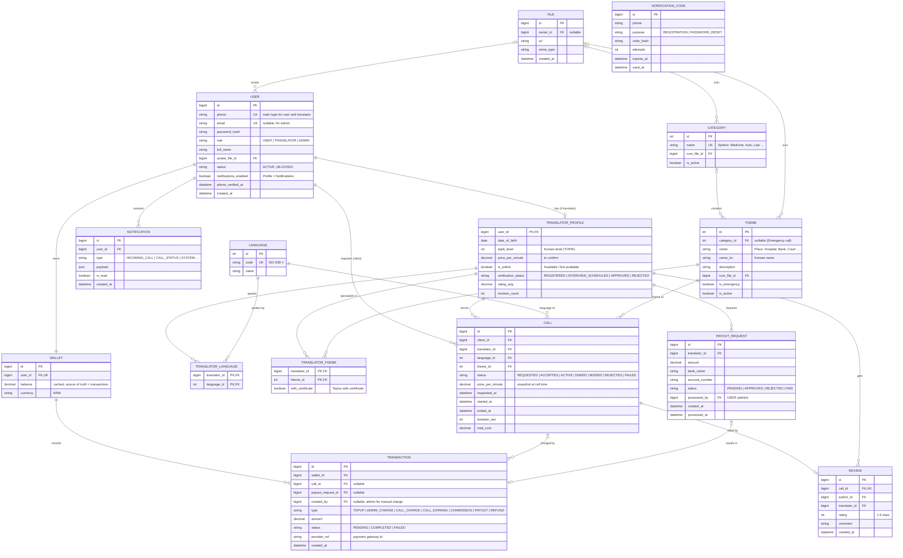

# MORAGO — ERD (первая версия для обсуждения)

> Модель данных составлена по макетам Figma (клиент, переводчик, админка), таблице мест/сфер и описанию проекта.
> Детали, которые не удалось однозначно определить по макетам, вынесены в раздел «Вопросы».

Цепочка работы: **макеты и требования → бизнес-сущности → связи → таблицы**.

## Обозначения

**Термины**

| Термин | Что значит | Пример из MORAGO |
|---|---|---|
| Сущность | «Вещь», о которой приложение хранит данные. Каждая сущность становится таблицей | User, Call, Wallet |
| PK (Primary Key, первичный ключ) | Поле, которое однозначно определяет одну запись, обычно `id`. Двух записей с одним PK не бывает | `call.id` |
| FK (Foreign Key, внешний ключ) | Поле, которое ссылается на запись в другой таблице. Так таблицы связываются | `call.client_id` указывает на `user.id` |
| UK (Unique Key) | Значение в поле не может повторяться | `user.phone`: два пользователя с одним номером невозможны |
| nullable | Поле можно оставить пустым | `theme.category_id` у «Экстренного вызова» |
| Связующая таблица | Третья таблица, которая раскрывает связь N:M. Каждая строка это одна пара | `translator_theme`: переводчик + тема |
| Снимок (snapshot) | Копия значения на момент события, которая потом не меняется | `call.price_per_minute` |
| Кэш | Готовое вычисленное значение, которое хранится для быстрого чтения, а источник правды лежит в другом месте | `wallet.balance` (источник правды: журнал `transaction`) |

**Типы связей** (примеры в разделе 4)

| Запись | Читается | Коротко |
|---|---|---|
| **1:1** | один к одному | У одной записи ровно одна парная запись с другой стороны |
| **1:N** | один ко многим | Одна запись связана со многими записями другой таблицы, а те в ответ связаны только с одной. **N** значит «сколько угодно»: ноль, один или много, это не конкретное число |
| **N:M** | многие ко многим | С обеих сторон «много». В базе всегда раскрывается через связующую таблицу |
| **1:0..1** | один к нулю или одному | «0..1» значит «не больше одного»: парная запись может быть, а может не быть |

**Линии на диаграмме.** Каждый конец линии показывает, сколько записей может быть с этой стороны:

| Символ | Значение |
|---|---|
| `\|\|` | ровно один |
| `\|o` | ноль или один |
| `o{` | ноль или много |
| `\|{` | один или много |

Пример: `USER ||--o{ CALL` читается слева направо как «один пользователь, ноль или много звонков», а справа налево как «у звонка ровно один пользователь (клиент)».

## 1. Диаграмма

Расшифровка обозначений (`PK`, `FK`, `UK`, типы связей, символы линий) находится в начале документа.

## 2. Как сущности получены из макетов

| Что видно в макетах | Сущность | Пояснение |
|---|---|---|
| Регистрация и вход клиента, переводчика, админа; пароль; код из SMS | **User**, **VerificationCode** | Одна таблица для трёх ролей, вход по телефону |
| Edit Profile переводчика: ФИО, дата рождения, уровень корейского (TOPIK), статус Available / Not available | **TranslatorProfile** | Данные, которые есть только у переводчика |
| SMS со ссылкой на интервью после регистрации переводчика | `verification_status` | Статусы проверки: регистрация → интервью → одобрен / отклонён |
| Чипы «Available translation languages» | **Language**, **TranslatorLanguage** | Связь N:M |
| Таблица мест и сфер (Больница, Банк, Суд ...), разделы Themes и Categories в админке, экран выбора темы | **Category**, **Theme** | Связь 1:N: сфера содержит места |
| «Topics for translator» и «Topics for translation with certificate» | **TranslatorTheme** | Связь N:M, флаг `with_certificate` |
| Экраны Call, Recent, история звонков | **Call** | Статусы, тема, язык, время, стоимость |
| Экран с пятью звёздами после звонка | **Review** | Один отзыв на звонок |
| Balance клиента и переводчика, Top up, Details | **Wallet**, **Transaction** | Баланс и журнал операций |
| Withdrawal of funds (банк, номер счёта, сумма) | **PayoutRequest** | Заявка на вывод |
| Админка: Charge, Deposit history, Withdraw, Withdraw history | **Transaction** (типы `ADMIN_CHARGE`, `PAYOUT`), `created_by` | Ручное пополнение и вывод оформляет админ |
| Экран Notification | **Notification** | История уведомлений |
| Аватары, иконки категорий и тем | **File** | Одна таблица для всех файлов |
| Админка: списки Translator и User, формы Add new, блокировка | **User**, **TranslatorProfile** (`status`, `verification_status`) | Новых таблиц не нужно |

## 3. Сущности

| Сущность | Зачем нужна | Главные поля |
|---|---|---|
| **User** | Один вход для всех трёх ролей (клиент, переводчик, админ) | `phone`, `password_hash`, `role`, `status` |
| **TranslatorProfile** | Данные, которые есть только у переводчика. В User они были бы пустыми у остальных | `topik_level`, `is_online`, `verification_status`, `rating_avg` |
| **Language** | Справочник языков для фильтра и звонка | `code`, `name` |
| **Category** | Сфера: группа тем (Медицина, Авто, Закон ...) | `name`, `icon_file_id` |
| **Theme** | Конкретное место внутри сферы (Больница, Банк, Суд ...) | `category_id`, `name`, `name_ko`, `is_emergency` |
| **Call** | Один звонок между клиентом и переводчиком, центральная сущность | `client_id`, `translator_id`, `theme_id`, `status`, `started_at`, `total_cost` |
| **Review** | Оценка после звонка | `call_id`, `rating`, `comment` |
| **Wallet** | Кошелёк пользователя (у клиента и у переводчика) | `user_id`, `balance`, `currency` |
| **Transaction** | Журнал: каждое движение денег отдельной строкой | `wallet_id`, `type`, `amount`, `status` |
| **PayoutRequest** | Заявка переводчика на вывод средств | `translator_id`, `amount`, `bank_name`, `account_number`, `status` |
| **VerificationCode** | SMS-код для регистрации и сброса пароля | `phone`, `purpose`, `code_hash`, `expires_at` |
| **Notification** | История уведомлений пользователя | `user_id`, `type`, `payload`, `is_read` |
| **File** | Все загруженные файлы в одном месте | `url`, `mime_type` |

Связующие таблицы **TranslatorLanguage** и **TranslatorTheme** раскрывают связи N:M.

## 4. Связи

В последней колонке указано поле, в котором хранится ссылка на связанную запись.

| Связь | Тип | Смысл связи | Как устроено в таблицах |
|---|---|---|---|
| User — TranslatorProfile | 1:1 (профиль необязателен) | У пользователя-переводчика ровно один профиль, у клиента и админа профиля нет. Профиль принадлежит одному пользователю | `translator_profile.user_id` одновременно PK и FK, поэтому второй профиль создать нельзя |
| User — Wallet | 1:1 | У пользователя один кошелёк, у кошелька один владелец | `wallet.user_id`, FK с UNIQUE |
| Category — Theme | 1:N | В одной сфере много мест, у места одна сфера (кроме «Экстренного вызова», у него сферы нет) | `theme.category_id`, FK, может быть пустым |
| TranslatorProfile — Language | **N:M** | Переводчик знает много языков, и на каждом языке говорит много переводчиков | Связующая таблица `translator_language`: два FK, вместе составляют PK |
| TranslatorProfile — Theme | **N:M** | Переводчик работает со многими темами, у темы много переводчиков | Связующая таблица `translator_theme`: два FK и флаг `with_certificate` |
| User (клиент) — Call | 1:N | Клиент делает много звонков, у звонка один клиент | `call.client_id`, FK |
| TranslatorProfile — Call | 1:N | Переводчик принимает много звонков, у звонка один переводчик | `call.translator_id`, FK |
| Theme — Call | 1:N | По одной теме бывает много звонков, у звонка одна тема | `call.theme_id`, FK |
| Language — Call | 1:N | На одном языке бывает много звонков, у звонка один язык | `call.language_id`, FK |
| Call — Review | 1:0..1 | У звонка может быть не больше одного отзыва (или ни одного), у отзыва ровно один звонок | `review.call_id`, FK с UNIQUE |
| TranslatorProfile — Review | 1:N | Переводчик получает много отзывов, отзыв адресован одному переводчику | `review.translator_id`, FK |
| Wallet — Transaction | 1:N | В кошельке много операций, операция относится к одному кошельку | `transaction.wallet_id`, FK |
| Call — Transaction | 1:N | По одному звонку несколько операций (списание, начисление, комиссия). Не у каждой операции есть звонок: пополнение к звонку не относится | `transaction.call_id`, FK, может быть пустым |
| TranslatorProfile — PayoutRequest | 1:N | Переводчик создаёт много заявок на вывод, заявка принадлежит одному переводчику | `payout_request.translator_id`, FK |
| PayoutRequest — Transaction | 1:0..1 | Заявке соответствует не больше одной операции вывода | `transaction.payout_request_id`, FK, может быть пустым |
| User — Notification | 1:N | У пользователя много уведомлений, уведомление адресовано одному пользователю | `notification.user_id`, FK |
| File — User, Category, Theme | 1:N | Один файл (картинку) могут использовать несколько записей, а у записи не больше одного файла (аватар, иконка) | `user.avatar_file_id`, `category.icon_file_id`, `theme.icon_file_id`, FK, могут быть пустыми |

**VerificationCode** не связана ни с одной таблицей внешним ключом: код отправляется на номер телефона ещё до создания пользователя.

## 5. Принятые решения

1. **Одна таблица User + TranslatorProfile**: у ролей общий вход и пароль, а данные, нужные только переводчикам, вынесены в отдельную таблицу, чтобы у клиентов и админов не было пустых полей.
2. **Баланс считается из журнала Transaction**, `Wallet.balance` это кэш. Записи журнала не меняются и не удаляются; баланс и журнал обновляются в одной транзакции БД.
3. **`price_per_minute` в Call это снимок** тарифа на момент звонка: смена цены не должна менять историю.
4. **Деньги хранятся как DECIMAL**, валюта KRW.
5. **Статусы переводчика**: после регистрации REGISTERED, после SMS со ссылкой на интервью INTERVIEW_SCHEDULED, затем админ ставит APPROVED или REJECTED. Принимать звонки может только APPROVED.
6. **Админ может создавать клиентов и переводчиков** (формы Add new / Add translator) и вручную пополнять баланс клиента (Charge).

## 6. Не включено в модель (нет в макетах)

- **Жалобы и модерация звонков** (Complaint). Упомянуты в описании проекта, но экранов нет.
- **Документы для проверки переводчика** (VerificationDocument). В макетах проверка идёт через интервью, загрузки документов не видно.
- **Чат** (Conversation, Message). Два клиентских экрана похожи на сообщения, но это не подтверждено.
- **Избранные переводчики**, **промокоды**, **расписание работы**. В макетах не найдены.

При необходимости соответствующие таблицы добавляются отдельно, остальная модель не меняется.

## 7. Seed-данные для Category и Theme (из таблицы мест)

| Сфера (Category) | Места (Theme) |
|---|---|
| Работа | Агентство труда, Завод, Мин труда |
| Медицина | Больница, Поликлиника, Вет клиника, Аптека |
| Авто | СТО, Авто салон, Прокат |
| Услуги | Рестораны, Свадебный салон, Банкетный зал, Магазин / Торговый центр, Салон красоты, Почта, Банк |
| Бизнес | Бизнес |
| Государственные учреждения | Гос страховка, Миграционный центр, Районный центр, Налоговая, Агентство недвижимости, Другое |
| Закон | Полиция, Прокуратура, Адвокатура, Суд, Нотариус |
| Образовательные учреждения (в таблице выделено красным, вероятно не утверждено) | Детский сад, Школа, Институт, Учебные курсы |
| без сферы | Экстренный вызов (`is_emergency = true`) |

Корейские названия и описания берутся из исходной таблицы. В самом низу таблицы есть ещё строка «Dentistry», её нужно уточнить.

## 8. Статус реализации

| Этап | Что сделано / будет сделано |
|---|---|
| **Готово (неделя 1)** | Каркас monorepo: `apps/web` (Vite + React + TypeScript), `apps/api` (Express + TypeScript, маршрут `/health`), `packages/contracts` (общие типы). Оба приложения запускаются из корня командой `pnpm dev`. Составлен этот ERD. |
| **Задание 2** | Перенос всей модели в `apps/api/prisma/schema.prisma`, миграции MySQL, seed (Language, Category, Theme), CRUD, регистрация и вход (JWT, bcrypt), роли, пагинация и фильтры, уведомления через Socket.io, основа WebRTC |
| **Задание 3** | Логика звонка (статусы, длительность, стоимость), Transaction и PayoutRequest (пополнение, списание, вывод), сигналинг WebRTC, хранилище файлов (S3, опционально) |
| **Финал** | Блокировка аккаунтов и проверка переводчиков, сброс пароля (VerificationCode), загрузка файлов, Swagger, логирование, деплой |

Таблицы в базе данных будут созданы после согласования ERD.

## 9. Вопросы

Эти вопросы влияют на структуру таблиц и требуют решения до создания схемы.

1. **Вход:** по телефону с SMS-кодом (как в Figma) или по email (как в заданиях)? От этого зависят поля User и VerificationCode, а также восстановление пароля. Сейчас в модели телефон.
2. **Цена звонка:** «Fee / Per call» на экране входящего звонка это цена за минуту или фиксированная цена за звонок, и кто её задаёт? Сейчас в модели цена за минуту, тариф у переводчика, снимок в Call.
3. **Чат:** есть ли переписка между клиентом и переводчиком? Два клиентских экрана похожи на сообщения, но это не подтверждено. Сейчас чата в модели нет.

## 10. Допущения (требуют подтверждения)

Модель построена на следующих допущениях:

- звонки только аудио (в Figma только аудио);
- «Topics for translation with certificate» это отметка `with_certificate`, без загрузки файла;
- оценку после звонка ставит только клиент;
- банковские реквизиты вводятся при каждом выводе и хранятся в PayoutRequest;
- комиссия платформы пишется отдельной строкой `COMMISSION` в журнале, размер задаётся в настройках;
- жалобы, модерация звонков и документы для проверки в этом этапе не делаются (экранов нет).
